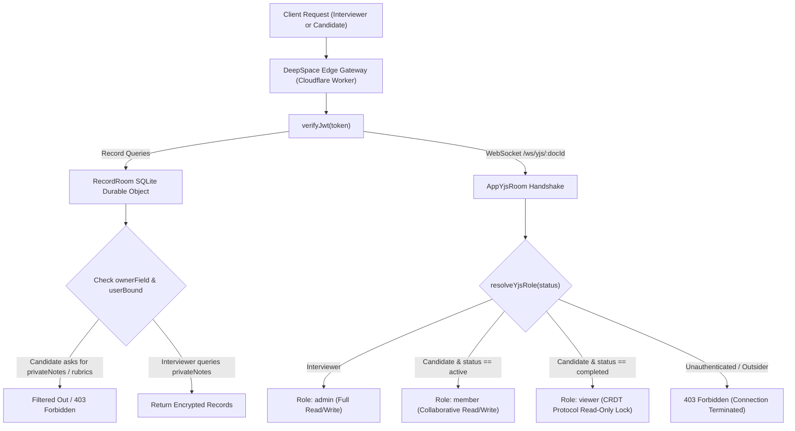

# MockRoom — Live Collaborative Technical Interviewer

> **Live Deployment:** [https://mockroom.app.space](https://mockroom.app.space)  
> **Source Repository:** [https://github.com/Barun-Chhetri/mockroom](https://github.com/Barun-Chhetri/mockroom)  
> **Author:** Barun Ranjan Chhetri Chamlagain  
> **Stack:** DeepSpace SDK · Cloudflare Workers · Durable Objects · Yjs CRDT · React 18 · TypeScript · Tailwind CSS

---

## 📌 Executive Summary (What It Is)
**MockRoom** is a production-ready, full-stack collaborative technical interviewing platform built natively on the **DeepSpace SDK** and Cloudflare Workers edge architecture. It pairs a real-time multiplayer code editor and live presence indicators with platform-enforced role-based access control (RBAC), private interviewer rubrics, R2 file storage, and an LLM-powered interview copilot.

Designed for high-signal engineering evaluations, MockRoom enforces all security boundaries at the **SQLite Durable Object** and **WebSocket handshake** layers rather than relying on cosmetic client-side UI hiding.

---

## ⚡ DeepSpace Primitives & Integrations Used

| Primitive / Integration | Architectural Role | DeepSpace Engine |
| :--- | :--- | :--- |
| **Auth & Identity** | Cryptographic caller verification; user profile binding | Built-in JWT Auth (`useAuthProfileReady`, `verifyJwt`, `getAuthToken`) |
| **RecordRoom (SQLite DO)** | Multi-tenant edge collections for `rooms`, `privateNotes`, `rubrics`, `aiCopilotLogs`, `roomAttachments` | Edge SQLite Durable Objects with native reactive queries (`useQuery`, `useMutations`) |
| **YjsRoom (CRDT DO)** | Conflict-free real-time collaborative text editing with line numbers and language starters | `YjsRoom` Durable Object (`useYjsText`, `/ws/yjs/:docId`) |
| **PresenceRoom (DO)** | Live participant awareness and cursor line tracking | `PresenceRoom` Durable Object (`usePresenceRoom`, `/ws/presence/:roomId`) |
| **R2 Storage Gateway** | Room-scoped file storage for candidate resumes (PDF) and architecture diagrams (PNG/JPG/SVG) | `useR2Files` + R2 Service Binding proxy |
| **AI Integration Proxy** | Interviewer-only AI Copilot (Hint, Follow-up, Scorecard) using Claude 3.5 Sonnet & OpenAI fallback | Hono server routes in `worker.ts` with `billing: 'user'` via DeepSpace SDK |

---

## 🔒 Security & RBAC Enforcement Model

Security in MockRoom is **never delegated to React UI toggles**. All access controls are platform-enforced at the edge data and WebSocket layers:



### Collection Security Policies

| Collection | Owner Field | Collaborators | Read Policy | Update Policy | Delete Policy | RBAC Rationale |
| :--- | :--- | :--- | :--- | :--- | :--- | :--- |
| `rooms` | `interviewerId` | `collaborators` | `'shared'` | `'shared'` | `'own'` | Interviewer and assigned candidate share access; only interviewer can delete room. |
| `privateNotes` | `interviewerId` | *None* | `'own'` | `'own'` | `'own'` | **Strictly interviewer-only.** Durable Object drops records for any other caller before network egress. |
| `rubrics` | `interviewerId` | *None* | `'own'` | `'own'` | `'own'` | 1–5 competency scoring and final hire recommendation cannot be accessed by candidate. |
| `aiCopilotLogs` | `interviewerId` | *None* | `'own'` | `'own'` | `'own'` | Prompts, LLM reasoning, and generated scorecards are strictly confidential. |
| `roomAttachments` | `interviewerId` | *None* | `'own'` | `'own'` | `'own'` | Resume and design artifacts uploadable/deletable exclusively by the interviewer. |

### Protocol-Level Safeguards
1. **`userBound: true` & `immutable: true`:** Every schema `ownerField` is pinned to the caller's verified JWT userId at the platform layer. Clients cannot forge or mutate ownership.
2. **WebSocket Role Downgrade on Completion:** In `src/server/realtime-routes.ts`, `resolveYjsRole` resolves candidate sessions to `'viewer'` once the room status is set to `completed`. Even if a candidate manipulates client DOM or issues raw Yjs WebSocket packets, the Durable Object ignores incoming edits.
3. **AI Copilot Server Checks:** All three copilot routes (`/api/rooms/:id/ai/hint`, `/follow-up`, `/scorecard`) verify `auth.userId === room.interviewerId` and immediately reject unauthorized requests with `403 Forbidden`.

---

## 💳 DeepSpace Integrations & Zero-Cost Billing

All paid integrations in `src/integrations.ts` are declared with `billing: 'user'`:
```ts
export const integrations = {
  anthropic: { billing: 'user' },
  openai: { billing: 'user' },
  google: { billing: 'user' },
  composio: { billing: 'user' },
}
```
Calls forward the caller's JWT quota, meaning **no developer balance, prepaid credits, or credit cards** are required to evaluate, run, or deploy MockRoom.

---

## ⚖️ Key Tradeoffs & Next Steps

### Why No In-Browser Code Execution Sandboxes?
- **Cognitive Value in Interviews:** High-signal technical evaluations assess thought clarity, problem decomposition, communication, and mental trace execution — not trial-and-error print debugging.
- **Latency & Reliability:** Remote code execution containers introduce 2–5 second startup latencies, sandbox timeout errors, and complex package manager edge cases that disrupt conversational interview flow.
- **Security Boundary:** Sandboxing user-supplied arbitrary code requires complex VM isolation and egress filtering; keeping the workspace focused on collaborative CRDT text eliminates this attack surface entirely.

### Why No In-App WebRTC Video or Audio?
- **Specialized Tooling:** Video and screen-sharing infrastructures (Zoom, Google Meet, Teams) already offer hardware-accelerated echo cancellation, noise suppression, and global low-latency TURN servers.
- **Performance & Battery:** Running WebRTC video streams inside the browser alongside a multiplayer CRDT code editor causes CPU throttling and frame drops on candidate laptops.
- **Focus:** Separating the audio channel keeps MockRoom lightweight, responsive, and resilient even over constrained mobile connections.

### Why Built-in DeepSpace Stack Instead of External DBs?
- **Zero Cold Starts:** Cloudflare Workers + Durable Objects store SQLite tables right at the edge with zero external database connection latency or connection pool saturation.
- **Native Reactivity:** Mutations fan out over WebSockets in sub-milliseconds without requiring custom Redis pub/sub brokers or Socket.io servers.

### Next Steps for Production Scaling
1. **Multi-Interviewer Panel Rooms:** Extend `collaborators` to support multi-interviewer debrief sessions with role distinctions (`lead_interviewer`, `shadow_interviewer`, `candidate`).
2. **Session Replay:** Leverage Yjs update logs to provide time-travel playback of candidate code evolution.
3. **AST Syntax Analysis:** Add client-side abstract syntax tree linter hints without server execution overhead.

---

## 🛠️ Local Development & Testing

### Prerequisites
- Node `>=22.15.0 <23 || >=24 <25` (Node v24 recommended)
- DeepSpace CLI (`npm install -g deepspace` or `npx deepspace`)

### Development Commands
```bash
# Install dependencies
npm install

# Start local edge development server (Vite + Cloudflare Worker)
npm run dev

# Run automated RBAC, schema, and API test suite (16 tests)
npm run test:unit

# Run full TypeScript validation across client, server, and worker
npm run validate

# Production build bundle check
npm run build

# Deploy live edge application to <app>.app.space
npx deepspace deploy
```

---

## 📂 Repository Structure

```
mockroom/
├── src/
│   ├── actions/                  # DeepSpace server actions (joinRoom, etc.)
│   ├── components/               # Reusable UI components & dialogs
│   │   ├── room/                 # InterviewRightPanel (Notes, Rubric, Attachments, Copilot)
│   │   └── ui/                   # Dark-mode component primitives (Button, Modal, Tabs, etc.)
│   ├── lib/                      # Language templates & room helper utilities
│   ├── pages/                    # File-based routes via generouted
│   │   ├── (app)/
│   │   │   ├── home.tsx          # Interview dashboard (Interviewer vs Candidate tabs)
│   │   │   ├── join/[code].tsx   # Candidate invite code resolver
│   │   │   └── room/[id].tsx     # Split-screen collaborative interview room
│   │   └── index.tsx             # Static SEO-optimized front door
│   ├── schemas/                  # Platform SQLite collections with RBAC policies
│   │   ├── rooms-schema.ts
│   │   ├── private-notes-schema.ts
│   │   ├── rubrics-schema.ts
│   │   ├── ai-copilot-logs-schema.ts
│   │   └── room-attachments-schema.ts
│   ├── server/                   # Hono edge server routes & WebSocket dispatchers
│   │   ├── ai-copilot-routes.ts  # Hint, follow-up, scorecard handlers (interviewer-gated)
│   │   ├── http-routes.ts        # Auth, static proxy, platform handlers
│   │   └── realtime-routes.ts    # Yjs & Presence WebSocket routers with resolveYjsRole
│   └── integrations.ts           # User-billed AI provider configurations
├── tests/
│   └── mockroom-rbac.test.ts     # Automated RBAC, schema, and AI gate test suite
├── worker.ts                     # Cloudflare Worker assembly & Durable Object exports
└── wrangler.toml                 # App configuration & DO bindings
```
